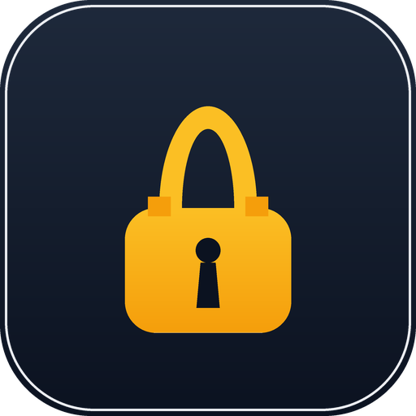

# dsh-lock-screen

[](LICENSE)

One-click lock screen for the DeepSeek Harness web GUI. A lock button in the
left sidebar footer hides the entire interface behind your current Windows
desktop wallpaper; press **Esc twice** to unlock.



## Install

**From the plugin market (dsh 0.2.1+):** open **Plugins → Discover** and search
for `dsh-lock-screen`. The listing is served from the curated
[awesome-dsh-plugin](https://github.com/awesome-dsh-plugin/awesome-dsh-plugin)
registry; before it is merged you can still install from source as below.

**From source** (requires `dsh web` / DSH Desktop):

```sh
dsh plugin --profile desktop add github:HandsYe/dsh-lock-screen
```

Replace `desktop` with your profile's actual name. On the official DSH Desktop,
install through **Settings → Plugins** instead — the Desktop manages its own
profile. Or use `plugin_manager` with the local path:

```
install_bundle target: D:\开发项目\碎碎念\dsh-lock-screen
```

**From a release tarball** (no build step, pinned to this version):

```sh
dsh plugin --profile desktop add https://github.com/HandsYe/dsh-lock-screen/releases/download/v0.1.0/dsh-lock-screen.tgz
```

The `tarball:` field in the catalog entry points at
`releases/latest/download/dsh-lock-screen.tgz`, which always tracks the newest
release.

Most installs go live without a restart; if the button does not appear, refresh
the page once.

## Usage

- A lock button (🔒) appears in the left sidebar footer, next to Settings.
- Click it to lock: the whole frame is covered by a full-screen layer showing
  the current Windows desktop wallpaper (`background-size: cover`). Nothing
  else is visible or clickable; key presses, wheel, and context menu are all
  swallowed.
- Press **Esc twice within 2 seconds** to unlock. After the first Esc a hint
  「再按一次 Esc 退出锁屏」appears at the bottom; the counter resets after the
  window elapses, and held-down key autorepeat is ignored, so an accidental
  single press cannot unlock the screen.

## How it works

- Client side (`lib/client.js`): a classic client module registered via
  `window.__ModuleLoader__.load`. It renders into two slots:
  - `sidebar.footer.action` — the lock button.
  - `shell.overlay` — the frame-wide lock layer (topmost z-index, above every
    column and panel).
- Host side (`lib/index.js`): serves `GET /dsh-lock-screen/wallpaper`, the
  current desktop wallpaper bytes, with MIME sniffed from magic bytes
  (jpeg/png/bmp/gif/webp). Resolution order on Windows:
  1. `%APPDATA%\Microsoft\Windows\Themes\TranscodedWallpaper`
  2. Newest image in `%APPDATA%\Microsoft\Windows\Themes\CachedFiles\`
  3. Registry `HKCU\Control Panel\Desktop` value `WallPaper`

  `GET /dsh-lock-screen/ping` returns which file was picked, for debugging.
- HTTP routes are registered on both the legacy web server and the Connection
  `/api` channel (`lib/http-transport.js`), so the desktop (`dsh-app:`)
  protocol and plain browser access both work.

If the wallpaper cannot be found (e.g. a solid-color wallpaper with no image
file), the lock layer falls back to a black background and shows the read error
in the hint line.

## No tools

The plugin registers no agent tools — it is a pure UI feature and never touches
the agent loop. The host side makes no network requests; wallpaper bytes are
read from local Windows paths only.

## Compatibility

Requires `dsh web` 0.1.0-rc.6 or newer (the `shell.overlay` and
`sidebar.footer.action` slots). Official `@deepseek-ai/*` packages are declared
as optional `peerDependencies`, so installs do not fail on hosts whose renderer
or web server versions differ. Windows wallpaper resolution is Windows-only;
on other platforms the overlay falls back to black unless a wallpaper image is
found in one of the probed paths.

## License

MIT — see [LICENSE](LICENSE).
